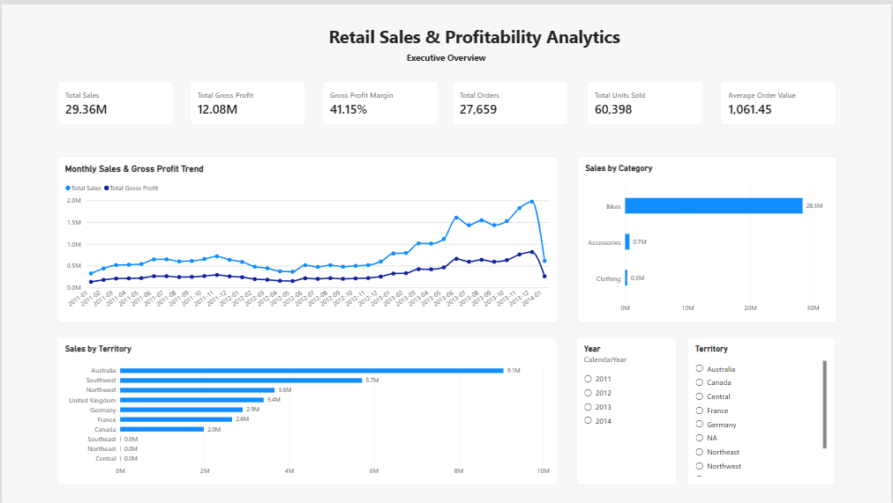
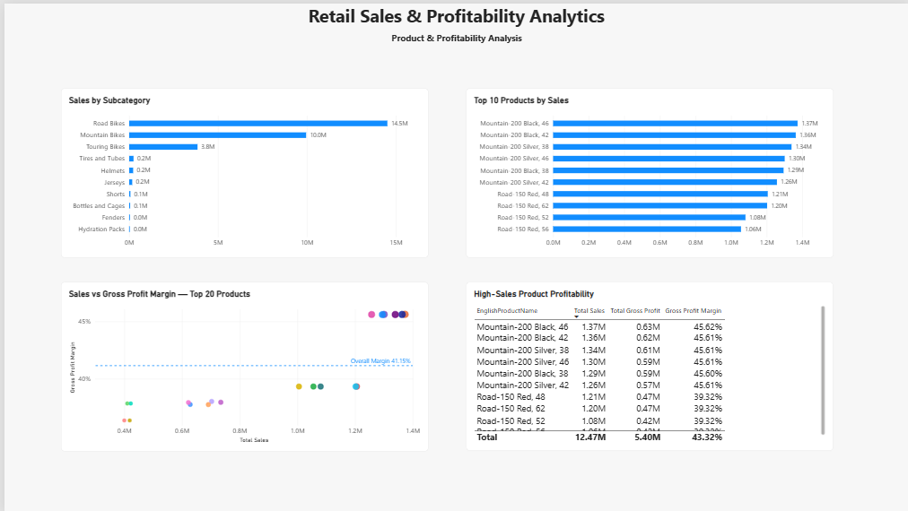
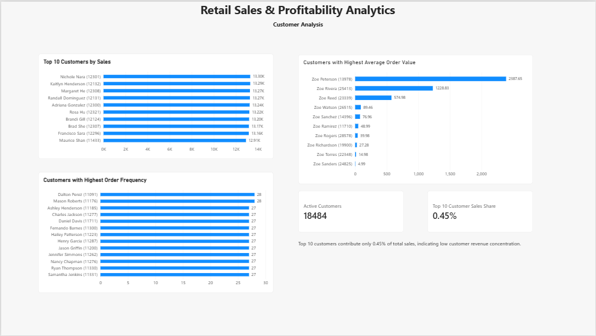

# Retail Sales & Profitability Analytics

## Project Overview

This project analyzes Microsoft AdventureWorks Internet Sales data to understand overall sales performance, profitability, product performance, customer behavior, and regional trends.

The workflow covers data cleaning and validation, relational data modeling, SQL analysis, KPI calculation, and interactive dashboard development in Power BI.

## Business Objectives

The analysis focuses on the following questions:

- How are sales and gross profit changing over time?
- Which product categories and subcategories drive the most revenue?
- Which products generate high sales, and how do their margins compare?
- Which territories perform best in sales and gross profit?
- Who are the highest-value and most frequent customers?
- How concentrated is revenue among the top customers?
- What is the month-over-month sales growth trend?

## Dataset

**Source:** Microsoft AdventureWorks Data Warehouse CSV files

Main tables used:

- `FactInternetSales`
- `DimProduct`
- `DimProductSubcategory`
- `DimProductCategory`
- `DimCustomer`
- `DimSalesTerritory`
- `DimDate`

The sales fact table contains **60,398 transaction-line records**.

**Fact table grain:** one row represents one product line within an internet sales order.

## Tools Used

- **Oracle SQL 10g** — relational analysis and business queries
- **SQL*Loader** — loading source CSV data into Oracle
- **Power Query** — data cleaning, transformation, merging, and validation
- **Microsoft Excel** — validation and exploratory analysis
- **Power BI** — data modeling and dashboard development
- **DAX** — KPI and analytical measure creation
- **Git & GitHub** — project documentation and version control

## Data Preparation & Validation

The source data was cleaned and validated before analysis.

Key validation steps included:

- Verified `ProductKey`, `CustomerKey`, and `SalesTerritoryKey` mappings
- Confirmed **60,398** fact-table rows after loading
- Confirmed no null values in `SalesAmount`
- Validated product hierarchy joins
- Validated date relationships
- Used `CustomerKey` as the unique customer identifier instead of customer name
- Cross-checked core KPI results between SQL, Excel/Power Query, and Power BI

Some source fields, such as product photos and multilingual descriptions, were excluded from the Oracle analysis tables because they were not required for business analysis.

## Data Model

The project uses a star-schema style model.

```text
DimDate
   |
   | OrderDateKey
   |
FactInternetSales ---- DimCustomer
   |
   | ProductKey
   |
DimProduct
   |
   | ProductSubcategoryKey
   |
DimProductSubcategory
   |
   | ProductCategoryKey
   |
DimProductCategory

FactInternetSales ---- DimSalesTerritory
```

Main relationships:

- `FactInternetSales.ProductKey` → `DimProduct.ProductKey`
- `FactInternetSales.CustomerKey` → `DimCustomer.CustomerKey`
- `FactInternetSales.SalesTerritoryKey` → `DimSalesTerritory.SalesTerritoryKey`
- `FactInternetSales.OrderDateKey` → `DimDate.DateKey`
- `DimProduct.ProductSubcategoryKey` → `DimProductSubcategory.ProductSubcategoryKey`
- `DimProductSubcategory.ProductCategoryKey` → `DimProductCategory.ProductCategoryKey`

## Core KPIs

| KPI | Result |
|---|---:|
| Total Sales | 29,358,677.22 |
| Total Gross Profit | 12,080,883.65 |
| Gross Profit Margin | 41.15% |
| Distinct Orders | 27,659 |
| Units Sold | 60,398 |
| Average Order Value | 1,061.45 |
| Active Customers | 18,484 |

**Gross Profit**

```text
Gross Profit = Sales Amount - Total Product Cost
```

This project uses gross/product-level profit, not net profit.

## Power BI Dashboard

The final report contains three analytical pages.

### 1. Executive Overview

Includes:

- Total Sales
- Total Gross Profit
- Gross Profit Margin
- Total Orders
- Units Sold
- Average Order Value
- Monthly Sales & Gross Profit Trend
- Sales by Category
- Sales by Territory
- Year and Territory slicers



### 2. Product & Profitability

Includes:

- Top subcategories by sales
- Top products by sales
- Sales vs Gross Profit Margin scatter analysis
- Overall margin reference line
- High-sales product profitability table



### 3. Customer Analysis

Includes:

- Top customers by sales
- Customers with highest order frequency
- Customers with highest average order value
- Active Customers KPI
- Top 10 Customer Sales Share KPI
- Customer concentration insight



## Key Business Insights

### Sales & Profitability

- Total sales reached **29.36M**, generating **12.08M gross profit**.
- Overall gross profit margin was **41.15%**.
- The dataset contains **27,659 distinct orders** with an average order value of **1,061.45**.

### Product Performance

- **Bikes** were the dominant revenue category, generating approximately **28.32M** in sales.
- Bikes contributed about **96.46% of total sales**.
- **Accessories** generated much lower revenue but showed a stronger gross margin of approximately **62.6%**.
- Road Bikes were the highest-sales subcategory at approximately **14.52M**.
- Mountain Bikes generated approximately **9.95M** and showed a stronger margin than Road Bikes.
- High unit volume did not always translate into high revenue. For example, Tires and Tubes sold many units but represented a relatively small share of total sales.
- High-sales products were not always the highest-margin products, showing the importance of analyzing both revenue and profitability.

### Regional Performance

- **Australia** was the highest-sales territory at approximately **9.06M**.
- Southwest and Northwest were also major contributors.
- Territory performance was evaluated using sales, gross profit, margin, and units sold rather than revenue alone.

### Customer Analysis

- The project identified **18,484 active customers**.
- Customer analysis used `CustomerKey` as the unique identifier to prevent customers with identical names from being combined.
- The top 10 customers contributed only approximately **0.45% of total sales**.
- This indicates **low customer revenue concentration**, meaning the business was not heavily dependent on a small number of customers.
- Order frequency and Average Order Value were analyzed separately because frequent customers are not necessarily the highest-spending customers per order.

### Time Analysis

- Monthly sales and gross profit trends were analyzed using the Date dimension.
- Month-over-month sales growth was calculated using the SQL `LAG()` window function.
- Partial periods at the beginning and end of the dataset should be interpreted carefully when comparing monthly performance.

## SQL Analysis

The SQL analysis includes:

1. Data and join validation
2. Overall business KPIs
3. Monthly sales and gross profit trend
4. Category performance
5. Subcategory performance
6. Top products by sales and profitability
7. Territory performance
8. Top customers by sales
9. Customer order frequency
10. Customer Average Order Value
11. Active customers
12. Top 10 customer sales share
13. Month-over-month growth using `LAG()`

SQL queries are available in:

```text
sql/analysis_queries.sql
```

## Repository Structure

```text
retail-sales-profitability-analytics/
│
├── data/
└── dataset documentation
│
├── images/
│   └── dashboard screenshots
│
├── powerbi/
│   └── Power BI report
│
├── sql/
│   └── analysis_queries.sql
│
└── README.md
```

## Analytical Approach

```text
Load → Clean → Validate → Model → Analyze → Visualize → Cross-check → Document
```

The project emphasizes validation before interpretation. Core results were cross-checked across SQL and Power BI to reduce calculation or data-loading errors.

## Skills Demonstrated

- SQL joins and aggregations
- Common Table Expressions (CTEs)
- Window functions such as `LAG()`
- `GROUP BY` and distinct-order analysis
- Data cleaning and validation
- Star-schema modeling
- Power Query transformations
- DAX measures
- KPI development
- Dashboard design
- Customer, product, territory, and time-series analysis
- Business insight communication

## Author

**Gauri Kotwal**  
Data Analyst | SQL | Power BI | Excel

[LinkedIn](https://www.linkedin.com/in/gauri-kotwal) | [GitHub](https://github.com/gaurikotwal)
